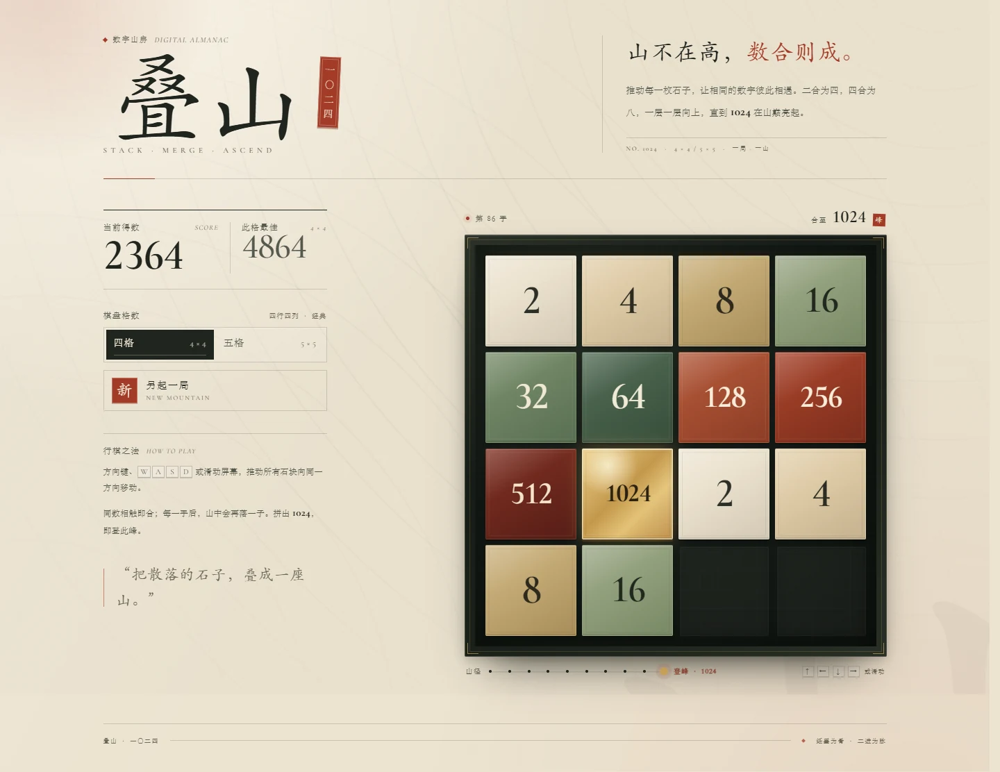
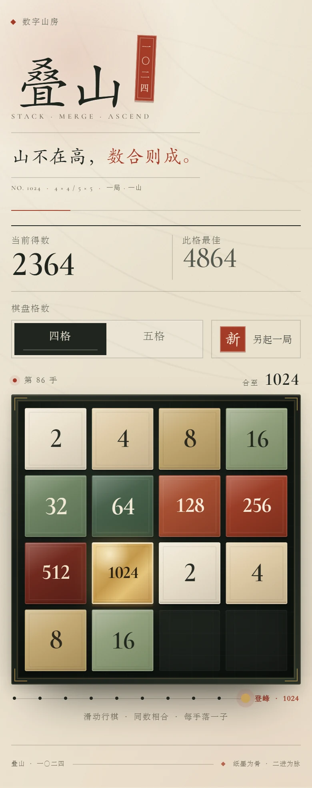

# 叠山 · 1024

> 以数叠山，合至一〇二四。

**叠山** 是一款以东方纸墨、山径与印章为视觉语汇的中文数字合并游戏。使用方向键或滑动屏幕推动方块，让相同的数字相遇、合并，最终在棋盘上拼出一枚 **1024** 方块。

游戏以单个 `index.html` 交付，不依赖框架、不依赖构建工具、不发起任何外部网络请求。打开文件即可游玩。



<details>
<summary>查看移动端预览</summary>

<br>



</details>

---

## 目录

- [项目简介](#项目简介)
- [功能一览](#功能一览)
- [快速开始](#快速开始)
- [玩法规则](#玩法规则)
- [操作方式](#操作方式)
- [计分、生成与难度](#计分生成与难度)
- [界面导览](#界面导览)
- [项目结构](#项目结构)
- [技术概览](#技术概览)
- [数据与隐私](#数据与隐私)
- [兼容性与无障碍](#兼容性与无障碍)
- [测试情况](#测试情况)
- [文档索引](#文档索引)
- [已知限制](#已知限制)
- [第三方组件与许可](#第三方组件与许可)
- [版本](#版本)

---

## 项目简介

本项目提供一个无需安装、无需账号、可离线游玩的中文数字合并游戏，并通过原生 HTML、CSS 和 JavaScript 展示完整的响应式前端交互。

源码与版本下载：[GitHub 仓库](https://github.com/throw29/dieshan-1024) · [v0.1.0 Release](https://github.com/throw29/dieshan-1024/releases/tag/v0.1.0)


| 项目 | 说明 |
| --- | --- |
| 游戏名称 | 叠山 · 1024 |
| 类型 | 单人数字合并 / 2048-like 益智游戏 |
| 平台 | 现代桌面与移动浏览器 |
| 技术栈 | HTML5 + CSS3 + 原生 JavaScript（ES2020+） |
| 交付形态 | 单文件，静态页面 |
| 后端 | **无**，纯前端本地游戏 |
| 数据存储 | 浏览器 `localStorage`（仅保存最佳成绩和所选棋盘） |
| 构建步骤 | **无** |
| 外部依赖 | **无**（Cormorant Garamond 字体已内嵌） |
| 目标 | 合并出数字为 `1024` 的方块 |

### 设计方向

界面以「数字山房」为题：米色宣纸、松烟墨、朱砂印章与鎏金高峰构成主色；棋盘像一方深色砚台，数字方块则像被反复叠放的石片。标题使用楷体，数字使用高对比衬线体，配合纸张颗粒、等高线纹理和诗性的中文文案，形成克制、沉静而带有手作感的游戏体验。

视觉与交互的完整说明见 [设计规范](docs/DESIGN_SYSTEM.md)。

---

## 功能一览

- **双棋盘模式**：`4 × 4` 经典棋盘与 `5 × 5` 从容棋盘。
- **原生键盘操作**：方向键与 `W / A / S / D`。
- **触屏与鼠标手势**：向任意方向滑动或拖动棋盘。
- **标准数字合并规则**：相同数字相撞后合并，每枚方块每手只参与一次合并。
- **随机落子**：每次有效移动后，在空位随机生成 `1`、`2` 或 `4`。
- **实时计分**：合并所得数字计入分数；每个棋盘尺寸拥有独立最佳成绩。
- **最佳成绩持久化**：刷新或重新打开页面后保留。
- **手数统计**：记录当前对局的有效移动次数。
- **山径进度**：直观显示从 `2` 到 `1024` 的登峰进度。
- **胜利与继续挑战**：合出 `1024` 后弹出「山成」界面，可继续挑战 `2048` 及更高数字。
- **失败判定**：棋盘无空位且相邻数字均不相同，则本局结束。
- **完整新开局**：随时重新开始，或切换棋盘尺寸。
- **响应式设计**：桌面、平板、横屏与手机分别优化。
- **无障碍基础能力**：键盘焦点、读屏状态播报、弹窗焦点管理、`prefers-reduced-motion` 支持。
- **完全本地运行**：无外部请求，字体与全部资源内嵌，可离线使用。

---

## 快速开始

### 安装与获取

无需安装运行时或依赖。从 Release 下载源码 ZIP 并解压，或执行：

```bash
git clone https://github.com/throw29/dieshan-1024.git
cd dieshan-1024
```

### 方式一：直接打开（推荐）

双击 `index.html` 即可在浏览器中开始游戏。页面没有服务端依赖，也没有外部资源请求。

### 方式二：本地静态服务器

如果希望通过 `http://` 访问，或需要在开发时验证浏览器行为，可在项目目录运行：

```bash
cd dieshan-1024
python -m http.server 8080
```

然后访问：

```text
http://localhost:8080
```

也可以使用其他任意静态文件服务器，例如：

```bash
npx serve .
```

> 游戏本身不需要安装任何依赖；上面的 `python` 或 `npx` 命令只是可选的本地预览方式。

### 部署

项目是纯静态单文件应用，将 `index.html` 上传到任意静态托管即可：

- GitHub Pages
- Netlify / Vercel
- Nginx / Apache / IIS 静态站点
- 对象存储静态网站托管

详细部署方式、缓存策略与安全响应头建议见 [部署与运维](docs/DEPLOYMENT.md)。

---

## 玩法规则

1. 游戏在 `4 × 4` 或 `5 × 5` 网格中进行。
2. 使用方向键、`WASD` 或滑动屏幕，让所有方块朝同一方向移动。
3. 相邻且数字相同的两个方块，在移动方向上相撞后会合并为一枚新方块，数字为两者之和：
   - `2 + 2 = 4`
   - `4 + 4 = 8`
   - `8 + 8 = 16`
   - 以此类推，直至 `1024`。
4. 每一枚方块在一次移动中最多只合并一次：
   - 向左移动 `[2, 2, 4]`，结果为 `[4, 4]`，不会继续合成 `[8]`。
   - 向左移动 `[2, 2, 2, 2]`，结果为 `[4, 4]`。
5. 每次有效移动后，棋盘会随机在一个空位落下一枚新方块：`1`、`2` 或 `4`。
6. 合并所得的数字会累加为当前得分。
7. 拼出数字为 `1024` 的方块即达成目标，游戏弹出「山成」界面。
8. 胜利后可选择继续游戏，向 `2048` 及更高数字挑战。
9. 当棋盘被填满，且横竖相邻位置都不存在相同数字时，本局结束。

### 输入输出示例

以一行向左移动为例（`0` 表示空格，下表展示随机落子前的结果）：

| 输入棋盘行 | 操作 | 合并结果 | 本次得分 |
| --- | --- | --- | ---: |
| `[2, 2, 4, 0]` | `←` | `[4, 4, 0, 0]` | 4 |
| `[2, 2, 2, 2]` | `←` | `[4, 4, 0, 0]` | 8 |
| `[512, 512, 0, 0]` | `←` | `[1024, 0, 0, 0]` | 1024，并触发胜利 |

每次有效移动后，整个棋盘的一个随机空位还会生成 `1`、`2` 或 `4`；无效移动不会落子或增加手数。

### 两种棋盘

| 棋盘 | 定位 | 最佳成绩 |
| --- | --- | --- |
| `4 × 4` | 经典难度，空间紧凑，适合熟悉玩法 | 独立保存 |
| `5 × 5` | 空间更从容，更适合长线挑战与新手 | 独立保存 |

切换棋盘会立即开始一局新游戏，并载入该尺寸对应的最佳成绩。

---

## 操作方式

| 操作 | 桌面 | 移动端 |
| --- | --- | --- |
| 向左移动 | `←` 或 `A` | 向左滑动棋盘 |
| 向右移动 | `→` 或 `D` | 向右滑动棋盘 |
| 向上移动 | `↑` 或 `W` | 向上滑动棋盘 |
| 向下移动 | `↓` 或 `S` | 向下滑动棋盘 |
| 重新开局 | 点击「另起一局」 | 点击「另起一局」 |
| 切换棋盘 | 点击「四格 / 五格」 | 点击「四格 / 五格」 |
| 关闭胜利弹窗 | `Esc` 或按钮 | 点击按钮 |

实现细节：

- 滑动识别阈值为 **24px**；低于该距离视为点击。
- 动画期间会暂时锁定输入，避免状态竞争。
- 无效移动不会增加手数，也不会生成新方块，棋盘会给出轻微的回弹反馈。

---

## 计分、生成与难度

### 计分

- 每次合并所得的新数字会加入总分。
  - `2 + 2 → 4`，得 `4` 分。
  - `8 + 8 → 16`，得 `16` 分。
- 一次移动中若发生多次合并，得分累加。
- 仅平移、未发生合并的移动不会得分，但会累计手数。
- 最佳成绩按棋盘尺寸分别保存：`4 × 4` 与 `5 × 5` 互不影响。

### 新方块生成概率

每次有效移动后，从所有空位中均匀随机选择一个位置，并按其固定概率生成数字：

| 数字 | 概率 |
| --- | ---: |
| `1` | 8% |
| `2` | 80% |
| `4` | 12% |

开局会生成两枚随机方块。理论上，游戏没有最高分上限；达到 `1024` 后仍可继续合并。

### 难度说明

`4 × 4` 棋盘需要更谨慎的空间规划；`5 × 5` 棋盘为玩家提供了更大的回旋空间，因此更容易触及 `1024`。玩家需要在清理低值方块、保留合并空间和维持大数字的角落布局之间取得平衡。

---

## 界面导览

| 区域 | 说明 |
| --- | --- |
| 刊头 | 游戏标题「叠山」、朱砂目标印「一〇二四」、主题文案 |
| 得分账簿 | 当前得分与当前尺寸最佳成绩，合并时带有数字跳动反馈 |
| 棋盘设置 | `四格 / 五格` 切换与「另起一局」按钮 |
| 对局状态 | 当前手数，以及「合至 1024」目标 |
| 棋盘 | 深色砚台式棋盘，内嵌纸质数字方块；`1024` 使用鎏金材质 |
| 山径 | 从 `2` 到 `1024` 的进度刻度与当前峰高 |
| 胜利界面 | 「山成」，显示本局得分与最高方块，可选择继续或另起一局 |
| 结束界面 | 「山止」，显示本局成绩，可另起一局 |

界面中的全部视觉元素均由 HTML/CSS 绘制，没有图片素材依赖。

---

## 项目结构

```text
1024/
├── index.html                  # 完整游戏：HTML + CSS + JavaScript + 内嵌字体
├── README.md                   # 项目总览与使用说明（本文件）
├── CHANGELOG.md                # 版本变更记录
├── THIRD_PARTY_NOTICES.md      # 第三方字体许可与版权说明
└── docs/
    ├── GAME_DESIGN.md          # 游戏设计、规则与交互规格
    ├── FRONTEND.md             # 前端架构、算法与实现说明
    ├── BACKEND.md              # 后端现状、本地数据层与可选后端设计
    ├── DESIGN_SYSTEM.md        # 视觉规范、颜色、字体与组件
    ├── TESTING.md              # 测试报告、验收清单与已知限制
    ├── DEPLOYMENT.md           # 部署、安全、缓存与运维
    └── images/
        ├── preview-desktop.webp
        └── preview-mobile.webp
```

> 当前版本是纯前端应用，**没有后端代码、接口服务或数据库**。`docs/BACKEND.md` 记录了这一现状、浏览器本地数据层，以及未来若引入排行榜 / 云同步时的后端设计方案。

---

## 技术概览

### 运行方式

```text
浏览器
┌──────────────────────────────────────────┐
│ index.html（单文件）                      │
│                                          │
│  HTML 结构  ──  CSS 视觉与动效             │
│      │                                   │
│  JavaScript 游戏逻辑 / 渲染 / 输入 / 弹窗  │
│      │                                   │
│      └── localStorage                    │
│           ├── 各棋盘最佳成绩               │
│           └── 最近选择的棋盘尺寸           │
└──────────────────────────────────────────┘

无服务器 · 无 API · 无数据库 · 无网络请求
```

### 实现要点

- **无依赖单文件**：HTML、CSS、JS 全部内联；Cormorant Garamond 字体以 `WOFF2` Base64 内嵌，页面启动后不发起外部请求。
- **DOM 方块渲染**：方块为绝对定位元素，使用 `translate3d()` 在棋盘内滑动；合并动画在两张方块汇聚后完成值替换与清理。
- **按行/列压缩合并**：移动算法沿运动方向逐行/逐列处理，先压缩再合并，并通过“本手已合并”标记保证每枚方块只合并一次。
- **异步状态保护**：动画期间锁定输入，并用代际计数 `generation` 防止重开或切换尺寸后旧动画继续修改新对局。
- **响应式测量**：通过 `ResizeObserver` 在棋盘尺寸变化时重新计算方块大小与落点，避免依赖固定像素。
- **本地持久化**：最佳成绩和棋盘偏好写入 `localStorage`；当前对局不落盘。
- **可访问性**：棋盘可聚焦、支持键盘操作；胜利/失败弹窗使用 `role="dialog"`、焦点圈定与 `inert` 背景；状态变化通过 `aria-live` 播报。
- **动效降级**：尊重 `prefers-reduced-motion`，在减少动态效果的系统中关闭滑动/弹出动画。

完整算法、状态模型和函数说明见 [前端技术文档](docs/FRONTEND.md)。

---

## 数据与隐私

游戏仅在浏览器本地保存两类数据：

| 存储键 | 类型 | 内容 | 示例 |
| --- | --- | --- | --- |
| `dieshan.best.v1` | JSON 字符串 | 两种棋盘各自的最佳分数 | `{"4":4864,"5":2136}` |
| `dieshan.size.v1` | 字符串 | 最近选择的棋盘尺寸 | `"4"` 或 `"5"` |

- 数据保存在当前浏览器的当前源下，不会上传到任何服务器。
- 清除浏览器站点数据会清除最佳成绩与棋盘偏好。
- 无登录、无统计、无追踪、无 Cookie、无外部字体或脚本请求。
- 在隐私模式或禁用本地存储的环境中，游戏仍可运行，但不会保留最佳成绩。

更完整的数据结构、容错策略和可选后端设计见 [后端与数据文档](docs/BACKEND.md)。

---

## 兼容性与无障碍

### 浏览器支持

建议使用近两年的主流现代浏览器：

- Chrome / Edge（Chromium）
- Firefox
- Safari（macOS / iOS）

页面使用了 `Pointer Events`、`ResizeObserver`、`inert`、CSS `clamp()` / `min()`、CSS 变量与内嵌 `WOFF2` 字体等现代能力。较旧浏览器可能缺少部分动画或焦点隔离行为，但核心玩法仍尽可能降级可用。

### 无障碍支持

- 棋盘支持 Tab 聚焦和方向键操作，声明了 `aria-keyshortcuts`。
- 棋盘标签会随最高方块和得分更新。
- 动态消息通过隐藏的 `aria-live="polite"` 区域播报（合并得分、新局、胜利、失败等）。
- 胜利 / 失败弹窗具备 `role="dialog"`、`aria-modal="true"`、标题和描述关联。
- 弹窗打开时背景页面设置为 `inert`，Tab 焦点限制在弹窗内；关闭后恢复棋盘焦点。
- 提供跳过链接、清晰的 `:focus-visible` 焦点环。
- 支持 `prefers-reduced-motion`。
- 文字与背景保持清晰对比；数字方块采用大号展示字体，以提升识别度。

无障碍属于基础实现，并非经过正式 WCAG 合规审计。详见 [测试文档](docs/TESTING.md)。

---

## 测试情况

发布前复验记录见 [v0.1.0 发布检查](docs/RELEASE_CHECK.md)。下述 40 项为项目原有测试记录，原始临时脚本未随项目提供。

当前版本在 Microsoft Edge（Chromium）中通过 Playwright 自动化测试与多尺寸视觉检查：

- **40 项自动化检查全部通过**，覆盖初始化、合并、计分、方向移动、无效移动、滑动输入、棋盘尺寸切换、胜利、失败、最佳成绩持久化及移动端布局。
- **随机对局测试**：使用减少动态效果模式连续随机行棋，游戏在第 48 手正确进入失败界面，无控制台异常。
- **离线验证**：在阻止所有外部网络请求的情况下，内嵌字体正常加载，页面无报错。
- **响应式检查**：覆盖 `1440 × 1000`、`1280 × 800`、`1024 × 768`、`820 × 1180`、`390 × 844`、`320 × 568` 等视口；移动端无横向滚动。

完整测试报告、测试矩阵和手动验收清单见 [测试文档](docs/TESTING.md)。

> 测试使用临时 Playwright 脚本与调试钩子完成；调试钩子未包含在发布版本中。

---

## 文档索引

| 文档 | 内容 |
| --- | --- |
| [游戏设计文档](docs/GAME_DESIGN.md) | 产品目标、完整规则、计分、生成概率、交互流程、状态机、验收标准 |
| [前端技术文档](docs/FRONTEND.md) | 单文件架构、DOM 结构、状态模型、移动合并算法、动画流程、函数索引、响应式实现 |
| [后端与数据文档](docs/BACKEND.md) | 当前无后端说明、localStorage 数据层、多标签页行为、可选排行榜 / 云同步后端设计 |
| [设计规范](docs/DESIGN_SYSTEM.md) | 视觉概念、颜色令牌、字体系、布局、方块色阶、组件与动效规范 |
| [测试文档](docs/TESTING.md) | 自动化测试报告、40 项测试记录、手动验收清单、环境与已知限制 |
| [部署与运维](docs/DEPLOYMENT.md) | 本地打开、静态托管、Nginx / GitHub Pages 部署、缓存、安全头、升级与回滚 |
| [变更记录](CHANGELOG.md) | 版本历史与改动摘要 |
| [第三方声明](THIRD_PARTY_NOTICES.md) | 内嵌 Cormorant Garamond 字体版权与 SIL OFL 许可说明 |

---

## 已知限制

- **无持久化存档**：只保存最佳成绩和棋盘偏好，刷新页面会开始新对局。
- **无后端**：不包含账号、在线排行榜、云同步或防作弊校验。
- **无音效**：当前版本为静音体验。
- **无撤销**：本版本按传统规则设计，不提供悔棋。
- **内部单文件结构**：为了“一份文件即可交付”，HTML/CSS/JS 共用一个文件，样式和逻辑体量较大；若继续扩展，建议拆分模块。
- **中文字体依赖操作系统**：标题楷体与正文字体使用系统 CJK 字体栈；不同系统上的字形可能略有差异。数字使用的 Cormorant Garamond 已内嵌，不依赖网络。
- **多标签页不实时同步**：两个标签页同时打开时，最佳成绩采用各自页面最后写入的值，不包含跨标签页同步逻辑。
- **无障碍非正式认证**：已实现基础键盘、焦点与读屏支持，但未进行正式 WCAG 审计。
- **测试范围有限**：自动化测试覆盖 Chromium 与移动视口；Safari / Firefox 仅按标准兼容性设计，未在本机实机回归。

---

## 第三方组件与许可

- **Cormorant Garamond**
  Copyright 2015 The Cormorant Project Authors
  Licensed under the SIL Open Font License, Version 1.1.
  字体以 Latin 子集形式内嵌在 `index.html` 中；完整许可证文本亦保存在该文件的样式注释内。详见 [THIRD_PARTY_NOTICES.md](THIRD_PARTY_NOTICES.md)。

- **项目代码许可**
  项目代码采用 [MIT License](LICENSE)。内嵌字体继续遵循 SIL OFL 1.1，详见第三方声明。

- 无其他 JavaScript 库、CSS 框架、分析脚本或图片素材依赖。

---

## 版本

| 项目 | 值 |
| --- | --- |
| 当前版本 | `0.1.0` |
| 发布日期 | 2026-10-20 |
| 文档语言 | 简体中文 |
| 主文件 | [`index.html`](index.html) |

---

<p align="center">
  <sub>把散落的石子，叠成一座山。</sub>
</p>
